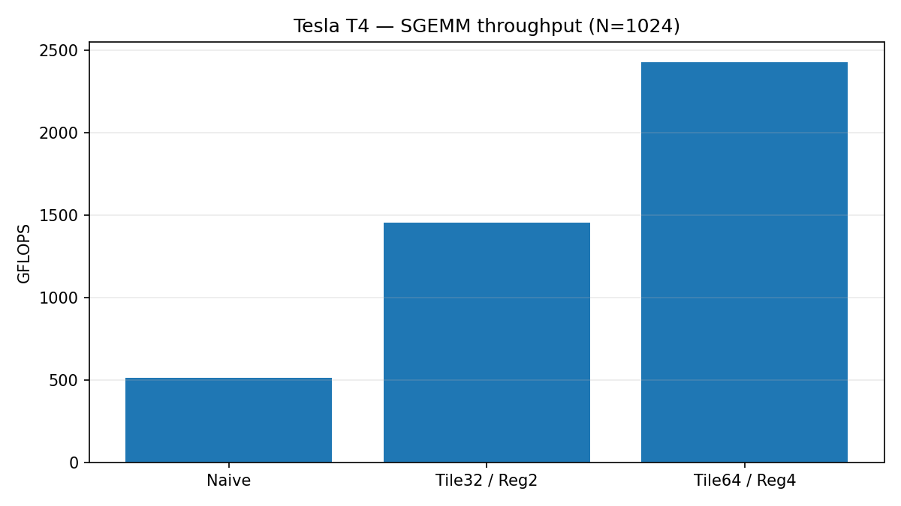

# CUDA SGEMM and Parallel Reduction — Tesla T4

**CUDA C++ performance-engineering project:** naive matrix multiplication, shared-memory tiling, register-blocked matrix multiplication, and shared-memory versus warp-shuffle reduction.

## Validated highlights

- **2.43 TFLOPS** for a 1024×1024 FP32 SGEMM with 64×64 output tiles and 4×4 per-thread accumulators (median across three independent notebook runs; **0.8843 ms**).
- **4.72× speedup** over the naive CUDA SGEMM baseline at N=1024 (median naive **4.1732 ms**).
- **1.77× reduction speedup** with warp-shuffle operations compared to the shared-memory baseline for 1,048,576 elements (0.01869 vs 0.03310 ms).
- All reported numerical checks passed for SGEMM sizes 127, 256, 512, 1024, 2048, and two reduction sizes. Note: SGEMM validation compares against cuBLAS, not an independent higher-precision CPU reference.



## Project structure

- `src/sgemm_reduction.cu`: tested V2 CUDA source, including kernels, cuBLAS reference, GPU-event timing, and correctness checks
- `notebooks/CUDA_SGEMM_Kaggle.ipynb`: Kaggle-ready implementation and benchmarking notebook
- `notebooks/CUDA_Validation_Kaggle.ipynb`: repeated-run validation and N=2048 stress test
- `results/`: **user-supplied Kaggle output** (raw CSV, logs, and validation figures)
- `docs/sgemm_throughput.png`: chart based on median of three independent runs

## Reproduce on Kaggle

1. Create a Kaggle notebook, enable an NVIDIA GPU, and import `notebooks/CUDA_SGEMM_Kaggle.ipynb`.
2. Run all cells. Confirm the GPU using `!nvidia-smi` and compiler using `!nvcc --version`.
3. Run `notebooks/CUDA_Validation_Kaggle.ipynb` to obtain repeat measurements and the larger test. Keep GPU model, CUDA version and compile options recorded in the output.
4. Expected CSVs: `sgemm_v2_results.csv`, `reduction_v2_results.csv`; the validation notebook packages further CSVs and logs.

Alternatively, in a CUDA-enabled Linux environment from the repo root:

```bash
nvcc -O3 -std=c++17 src/sgemm_reduction.cu -lcublas -o cuda_sgemm
./cuda_sgemm
```

**Implementation note:** the C++ source writes result CSVs to `/kaggle/working/` when available; on another system the fallback output filenames are in the working directory.

## Methodology

- GPU: NVIDIA Tesla T4, compute capability 7.5.
- Operations: FP32 row-major C=A×B, with cuBLAS column-major interpretation via swapped operands.
- Measurements: CUDA events, warm-up, seven repetitions of ten launches in the V2 benchmark; repeated notebook runs for validation.
- Timings **exclude device allocation, host↔device transfer, and most notebook overhead**; reduction timing includes all GPU reduction stages.
- GFLOPS formula: `2*N**3 / (median_ms*1e6)`.
- Precision: cuBLAS is configured using `CUBLAS_PEDANTIC_MATH`; this alone does not prove identical floating-point instruction paths between all kernels.
- Correctness: compare against cuBLAS for SGEMM with the tolerance coded in `src/sgemm_reduction.cu`; compare reduction sums against double-precision CPU accumulation with relative tolerance.

## N=1024 independent-run validation

| Kernel | Median of run medians | Throughput |
|---|---:|---:|
| Naive | 4.1732 ms | 514.6 GFLOPS |
| Tile32 / Reg2 | 1.4789 ms | 1452.1 GFLOPS |
| **Tile64 / Reg4** | **0.8843 ms** | **2428.6 GFLOPS** |

The optimized Tile64 timings across independent runs were 0.8843, 0.8717, and 0.9046 ms.

**cuBLAS comparison caution:** at N=1024 cuBLAS medians varied from **0.3394 to 0.6502 ms** across the three runs, with a separate test recording 0.3719 ms. Therefore the originally observed 96.5% of cuBLAS is **not a reproducible headline figure**. No fixed percent-of-cuBLAS performance claim is made.

**N=2048 stress test:** 7.9087 ms / 2172.3 GFLOPS for Tile64/Reg4 versus 38.3686 ms for naive; cuBLAS 4.0180 ms in that particular run.

## Limitations and next experiments

- Kernel time may be influenced by GPU clocks, concurrent jobs, caching and GPU allocation, particularly in shared cloud notebooks.
- A fully independent high-precision CPU-reference check and input-pattern stress suite would further strengthen numerical validation.
- Exact clock-state control and detailed Nsight Compute counters may be unavailable on Kaggle.
- Future optimizations: sweep tile/block sizes and register usage; investigate compute vs memory limitations; compare additional matrix sizes and repeated full-run timings under controlled GPU load.

## Interview topics

Be ready to explain coalesced accesses, shared memory, register reuse, output tiles, synchronization, numerical tolerance, CUDA-event timing, arithmetic intensity, cuBLAS variance and why a naive kernel can outperform tiled variants at small N.

## Results provenance

The `results/` directory contains CSVs/logs supplied from Kaggle execution. The source and notebooks are preserved; no synthetic benchmark timings are substituted for GPU measurements.
